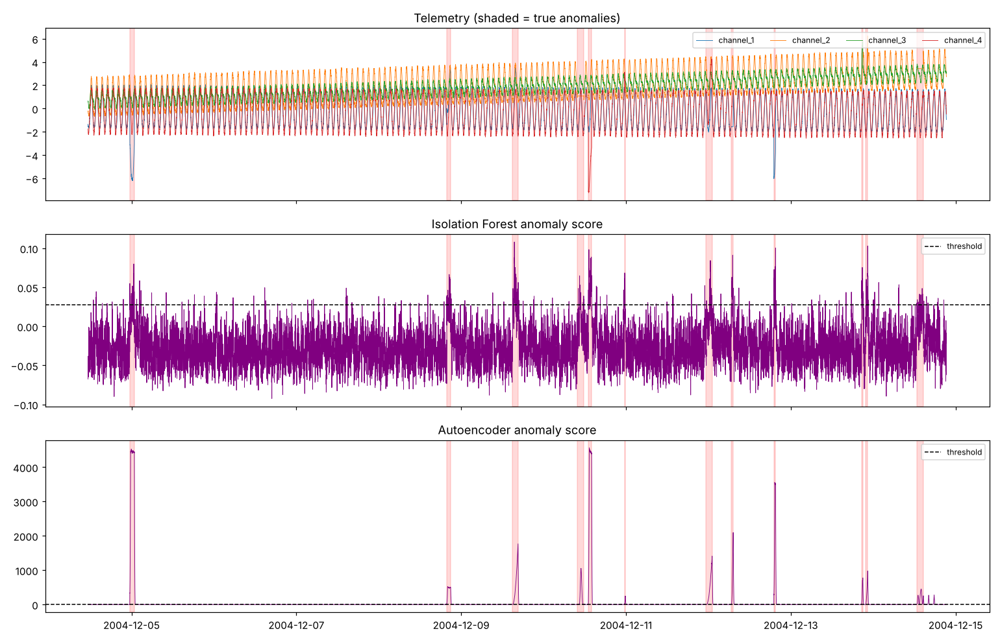

# Spacecraft Telemetry Anomaly Detection 🛰️

Unsupervised detection of anomalies (spikes, level shifts, drifts and stuck sensors) in multi-channel spacecraft telemetry, using an **Isolation Forest** and an **autoencoder** on rolling-window features. Includes a loader for the real [ESA Anomaly Detection Benchmark](https://zenodo.org/records/12528696) (ESA-Mission1) and a realistic synthetic telemetry generator for development and testing.



## Results (synthetic telemetry)

20,000 one-minute samples, 4 channels, about 3.9% anomalous. Mean ± std over 5 random seeds (`python run_experiment.py --repeats 5`):

| Model | Precision | Recall | F1 | Point-adjusted F1 | Events caught | ROC-AUC | PR-AUC | Alarm rate |
| --- | --- | --- | --- | --- | --- | --- | --- | --- |
| Autoencoder | 0.61 ± 0.02 | 0.95 ± 0.01 | **0.74 ± 0.02** | 0.77 ± 0.02 | 98% | **0.98** | **0.84 ± 0.02** | 7.6% |
| Isolation Forest | 0.59 ± 0.08 | 0.31 ± 0.07 | 0.41 ± 0.08 | **0.89 ± 0.03** | 93% | 0.92 | 0.48 ± 0.10 | 2.6% |

- The **autoencoder** flags almost every anomalous minute and ranks anomalies best (PR-AUC 0.84).
- The **Isolation Forest** raises fewer alarms and still catches 93% of anomaly *events*, but flags only part of each event (hence a high point-adjusted F1 and a low point-wise recall).
- Accuracy isn't reported because with 4% anomalies it is misleading. PR-AUC is the headline metric.

## How it works

1. **Features** (`spacecraft_ad/features.py`): for every channel, rolling std, first difference, deviation from a rolling median, and the difference from the same orbit phase (median of the last 3 orbits). All features are *relative*, so slow mission-long drift doesn't trigger alarms, and comparing with past orbits catches stuck sensors and drifts that look normal sample by sample.
2. **Training**: detectors are fitted on the first 20% of the series (assumed normal) and the alarm threshold is the 99.5th percentile of scores on the next 5%. No labels are used for training or thresholding.
3. **Evaluation** (`spacecraft_ad/evaluate.py`): on the remaining 75%, point-wise precision/recall/F1, point-adjusted F1, event recall, ROC-AUC and PR-AUC.

### What changed from the original notebook

`Spacecraft_Anomaly_Detection.ipynb` is kept for reference, but its numbers aren't valid. It evaluated on generated sine waves where the "anomaly" window covered 88% of samples, it set thresholds from the true anomaly rate, and it doesn't run top to bottom. Developing this pipeline also turned up two feature problems, both fixed and recorded in the commit history: absolute-level features caused alarm rates of about 50% under drift, and one-orbit differencing made every anomaly "echo" one orbit later.

## Getting started

```bash
git clone https://github.com/Aswin20122005/Spacecraft-Anomaly-Detection.git
cd Spacecraft-Anomaly-Detection
pip install -r requirements.txt

python run_experiment.py                       # synthetic data
python run_experiment.py --repeats 5           # mean ± std over 5 seeds
python run_experiment.py --plot results/plot.png
```

### Real ESA data

Download `ESA-Mission1.zip` from [Zenodo](https://zenodo.org/records/12528696), extract it to `data/ESA-Mission1`, then:

```bash
python run_experiment.py --esa data/ESA-Mission1 --channels channel_12 channel_13 --period 95
```

`--period` is the number of samples per orbit after resampling to 1 minute.

## Project structure

```
├── run_experiment.py        # CLI: load data, fit, evaluate, plot
├── spacecraft_ad/
│   ├── synthetic.py         # realistic telemetry generator with labelled anomalies
│   ├── esa.py               # ESA-ADB mission loader
│   ├── features.py          # rolling / orbit-relative features
│   ├── detectors.py         # Isolation Forest and autoencoder
│   ├── evaluate.py          # time-series anomaly metrics
│   └── plots.py             # result figure
├── tests/                   # pytest suite
└── Spacecraft_Anomaly_Detection.ipynb   # original exploration (see note inside)
```

## Development

```bash
pip install -r requirements-dev.txt
pytest
flake8 .
```

GitHub Actions runs lint, the tests and a 3-seed experiment on every push.

## Tech stack

Python · NumPy · pandas · scikit-learn · Matplotlib · pytest
